# Registration Client UI refresh (UX4G foundations)

A redesign of the JavaFX registration client on the foundations of **UX4G 3.0**, the Government of
India design system ([ux4g.gov.in](https://ux4g.gov.in); token values taken from the MIT-licensed
`ux4g-web-components` package). It also includes the fix needed to run the Java 21 client on macOS
(Apple Silicon). Based on `develop` (Java 21, 1.3.0-SNAPSHOT).

**Contract and upgrade safety:** layouts were rebuilt where needed, but every `fx:id`, `onAction`/handler
name, controller field type and public method is unchanged. The work is in FXML and CSS plus a few
isolated UI-construction tweaks, so later MOSIP upgrades merge cleanly. The only nodes removed are two
decorative separator lines in the app bar and the static, unpopulated "News and Updates" placeholder on
Home. Nothing in the code referenced either.

## Design system

All visual values are tokens on `.root` in
[`application.css`](../../registration/registration-client/src/main/resources/application.css).

| Foundation | UX4G value used |
| --- | --- |
| Font | Noto Sans Regular / Medium / SemiBold / Bold, bundled (`resources/fonts`, SIL OFL 1.1) |
| Brand | Primary 600 `#4A2BC2`; hover 700 `#3D239F`; pressed 800 `#301C7D`; tint 50 `#F2EFFF` |
| Chrome | Primary 900 `#24145C` app bar |
| Neutrals | Text `#171717` / `#404040` / `#737373`. Surfaces carry a faint primary tint so cards sit softly on the page: canvas `#EEEDF4`, cards `#FBFBFD`, dividers `#E4E2EC` |
| Inputs | White field `#FFFFFF` with a `#928EA3` boundary (about 3:1, per UX4G's control-contrast rule), 2px primary focus ring, attached keyboard suffix |
| Status | Success `#128937`, error `#DB372D`, warning `#D46B08`, info `#08979C`, each with a soft tint |
| Spacing | 4px grid (8 / 12 / 16 / 24 / 32); 32px page margins, 24px gutters |
| Radius | 8 for controls, 12 for cards, 999 for chips |
| Elevation | Soft key + ambient shadows (levels 1-2) |
| Type and controls | 15px base, 44px inputs and buttons (UX4G minimum target); in the 992px wizard card, 296px field slots (252px input + 44px keyboard, or a dropdown) give three per row and multi-language groups (452px) two per row; 72px date parts; 120px chips |

## Screens redesigned

| Screen | What changed |
| --- | --- |
| App bar (`Header.fxml`) | Brand (logo + product name) and primary navigation (Home, End of day for supervisors, Application upload, each behind the existing page-navigation confirmation) on the left; online status, settings, the signed-in user and the user menu on the right |
| Home (`RegistrationOfficerPacketLayout.fxml`) | Task dashboard on a centred 1280px column: welcome line with centre and machine, last-sync card with Sync now, items needing attention (live counts, supervisors only), registration processes as cards with a one-line description (New registration as the primary card), end-of-day and operational tasks as list cards |
| Login (`RegistrationLogin.fxml`) | Even split: brand panel (logo, product name and tagline, registration centre and machine read from the local DB) and sign-in panel (heading, subtitle, labelled 48px fields). Multi-factor login shows "Step n of m" for the configured factors |
| Registration wizard (`GenericRegistrationLayout.fxml`) | Step rail (current, completed, skipped by a process rule, error; "Step n of m" with progress) beside a fixed-width content card; the TabPane stays as the step model with its headers hidden. Works for any number of process-spec screens |
| Form fields (code-built) | Labels above inputs; hidden helpers take no space; chip groups labelled like other fields. With several data-entry languages a text field is one grouped control with a row per language (tag in the language's own name, field name in that language as placeholder, keyboard); other field types show the field name in the first language with the other languages on a muted line |
| Right-to-left | Arabic (or any configured RTL language) as the main language mirrors the whole screen; an RTL row inside an LTR form types RTL while the rows stay aligned |
| Pending approval | Decision counts in the page header; review card header with the selected application, its decision and Approve / Reject; "n of m decided" in the action bar |
| Update UIN | Page header with the process name from the spec; labelled UIN field; option cards in process-spec order |
| Operator onboarding (`Biometrics.fxml`) | Page template: breadcrumb and title, one card with the modality rail, capture panel and quality bar, exceptions column; Back / Save in the action bar |
| Biometrics capture | Modality rail beside the capture panel; compact layout (`fieldLayout: compact`) captures in a popup |
| Server HTML templates | Acknowledgement, preview, dashboard and consent are themed by a client-side layer (`template-theme.css`, applied as the WebView user stylesheet through `TemplateTheme.apply`). Template data is not modified, so the theme survives every sync |
| Page template (Pending approval, Re-registration, Application upload, Acknowledgement, Settings, Update UIN, Onboarding) | One structure everywhere: page header (breadcrumb, title, actions), content in cards on the canvas, one action bar at the bottom |
| Everything else | Picks up the tokens: tables, dialogs, menus, settings, upload, re-registration |

### Code touched

UI construction, plus the behaviour fixes listed below. New FXML nodes are optional `@FXML` fields; existing
`fx:id`s, handlers and public methods are unchanged (the only removed nodes were unreferenced: two app-bar
separators, the empty News placeholder on Home, three unused tracker nodes in `Biometrics.fxml`).

- `GenericController`: step rail; wizard card sized by anchors; the Continue path reports what blocks a step.
- `PacketHandlerController`, `HeaderController`, `LoginController`, `RegistrationApprovalController`, `UpdateUINController`, `BiometricsController`: data for the new page elements.
- `FxControl` (`collapseWhenHidden`, `primaryLabel`, `secondaryLabels`, `getInvalidReason`), `TextFieldFxControl` (language rows), `DropDownFxControl`, `ButtonFxControl`, `DOB*FxControl`, `DocumentFxControl`, `BiometricFxControl`.
- `BaseController`: `getLabelOrDefault`, `setTokenizedText`.
- `ClientPreLoader`: themed startup window.

## Verified variations

Each was run through the real UI to an acknowledgement and a packet in the local DB, with offline data
derived from the core MOSIP sample data (`mosip/mosip-data`).

| Area | Variations |
| --- | --- |
| Process / UI spec | Core `newProcess`, `updateProcess`, `lostProcess`, `bioCorrectionProcess`; 7-screen spec with long screen names and a screen hidden by an MVEL rule; pre-registration fetch on a later screen; biometrics none, partial (4 fingers + face), face only, compact layout |
| Data-entry languages | English only; English + Arabic; Arabic (main, whole screen RTL) + English; English + Sinhala + Tamil; English + Arabic + Sinhala + Tamil, with transliteration enabled on name and address fields |
| Biometric exceptions | Two fingers marked (exception photo required, reviewer authentication by a second supervisor); marked then unmarked (no photo, no reviewer); all fingers and irises marked (scan disabled for those modalities, face + photo) |
| Biometric login | Fingerprint (left / right slab, thumbs), iris, face, fingerprint + iris + face, face + password; wrong person; no device; modality not enrolled |
| End of day | Approve, reject with reason, supervisor authentication, decisions persisted |
| Window sizes | Full standard flow at 1280×680 and 1366×728 (1280×720 / 1366×768 screens minus the Windows taskbar), 1536×824 (1920×1080 at 125% scaling) and 1728×975; every screen fits, long screens scroll |

Biometric devices and the matcher were exercised with a dev-only SBI stand-in (outside this repo) and
MOSIP's mock SDK; everything above the device layer is the real client.

## Behaviour fixes (bugs found on `develop` while testing)

- **Compact biometrics crashed** (`retryBox` NPE): the popup FXML was loaded into a second, prototype-scoped
  controller. It now binds to the calling controller; the missing `sdkQualityText` label was added to the
  popup; the popup opens only when the operator picks a modality.
- **Capture recovery**: after a stream failure or missing device the biometrics pane stayed disabled with
  auto-logout off. **Streamer**: at end of stream the reader spun forever on `read() == -1`.
- **Biometric login**: a capture failure was reported as "match not found" and counted as a failed login
  (towards the lock); an operator without templates for the required modality was told "match not found".
  Both now say what happened and are not counted. Unexpected task failures no longer leave the pane disabled.
- **Transliteration cascade**: text written by transliteration triggered the other fields' transliteration,
  so with three or more languages values were overwritten by transliterations of transliterations. Only
  operator input is transliterated now.
- **Blocked steps without a reason**: Continue on an invalid step only marked the step red (upstream TODO for
  the exception photo). The footer now names the field or the reason; the exception photo tile is flagged
  until captured.
- **Update UIN** threw an NPE on load (`backBtn` referenced but missing in the FXML).

## Deployment notes

- **Transliteration needs a plugin.** The client looks up any Spring `Transliteration` bean; none is shipped
  in this build, so transliteration silently does nothing until one is added to `lib`. MOSIP's
  `kernel-transliteration-icu4j` (ICU 73) handles English and Arabic in both directions and English to
  Tamil (letter by letter; digits become Tamil numerals). **ICU has no Latin to Sinhala transliterator**, so
  with the stock plugin Sinhala must be typed; a Sinhala-capable `Transliteration` implementation can be
  plugged in.
- **Each data-entry language needs client bundles** (`labels_<lang>` / `messages_<lang>`); without them the
  language is shown but cannot be selected. This build ships en, fr and ar.
- **macOS on Apple Silicon (dev only):** OpenCV has no macOS-arm64 build, so preview and acknowledgement
  cannot decode JPEG2000 biometric images there; production platforms are unaffected.
- JavaFX misplaces spaces next to digits inside right-to-left text; the new texts that mix the two (step
  progress, decision summary) are laid out as word tokens to avoid it.

## macOS / Apple Silicon fix

`RegistrationAppHealthCheckUtil` used OSHI 3.6 only to check free disk space, and its lookup only
matched Windows drive letters (`user.dir.substring(0, 3)`). OSHI pulled in JNA 4.5.1, which has no
`darwin-aarch64` native library, so the Spring context failed to start on Apple Silicon. The check now
uses `java.nio.file.Files.getFileStore`, and OSHI is removed from `registration-services`.

## Running locally on macOS (dev)

```bash
cd registration
mvn clean install -Dgpg.skip -DskipTests -Dmaven.javadoc.skip=true
```

The Windows `run.bat` assumes a JRE that bundles JavaFX (Zulu FX). On a standard JDK 21, put the
`*-mac-aarch64` JavaFX jars on the module path:

```bash
java --module-path <javafx-mac-aarch64-jars> \
     --add-modules=javafx.controls,javafx.fxml,javafx.swing,javafx.web,javafx.media \
     --add-exports javafx.graphics/com.sun.javafx.application=ALL-UNNAMED \
     --add-opens java.base/java.lang=ALL-UNNAMED \
     -cp "lib/*" io.mosip.registration.controller.Initialization
```

Also add `registration-api-stub-impl` to `lib/`; production adds the geo-position and scanner
implementations during packaging.

`Initialization` (in `_launcher.jar`) checks for a signed `MANIFEST.MF` / `lib/MANIFEST.MF` before it
starts the client. Production packaging (`configure.sh`) creates those files, but a plain dev build has
none, so the launcher stops at that check. For local UI work, call
`io.mosip.registration.launcher.NormalStartup.launch(args)` from a small dev main instead; it is the same
Java 21 start path the launcher uses after verification.

The screenshots were taken from this build with offline mock data: the official MOSIP 1.2.0 sample ID
schema, UI specs (`newProcess`, `updateProcess`, `lostProcess`, `bioCorrectionProcess`) and master data
from `mosip/mosip-data`. A dev-only harness, kept outside this repo, seeded that data and drove the UI.

## Notes

- **Dashboard**, **preview** and **acknowledgement** bodies are server-synced templates. On screen, the
  client theme layer restyles them; printed or stored copies keep the template's own styling unless the
  templates are also updated on the server. The `$keyList.get("activityValue")` text on the Dashboard is an
  unresolved variable in MOSIP's sample template data.
- On a partial biometrics spec, attributes not configured for a displayed modality are recorded as
  exceptions (long-standing `develop` behaviour), so the exception photo and reviewer authentication apply.
- `application-pink.css` (the alternate theme) is untouched.

## Screenshots

| | |
| --- | --- |
|  Startup |  Login |
|  Login: password |  Home |
|  New registration: consent |  Demographics |
|  Documents |  Document scan |
|  Biometrics |  Preview |
|  Operator authentication |  Acknowledgement |
|  Pending approval |  Reject reason |
|  Supervisor authentication |  Re-registration |
|  Application upload |  Dashboard |
|  Update UIN |  Update UIN: demographics |
|  Lost UIN |  Biometric correction |
|  Settings |  Scheduled jobs |
|  Global config |  Devices |
|  Operator onboarding | |

### Variations

| | |
| --- | --- |
| 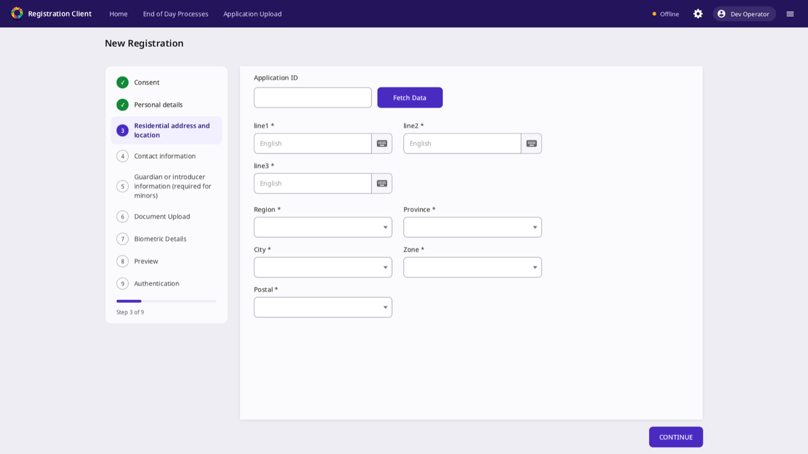 7-screen spec, long step names | 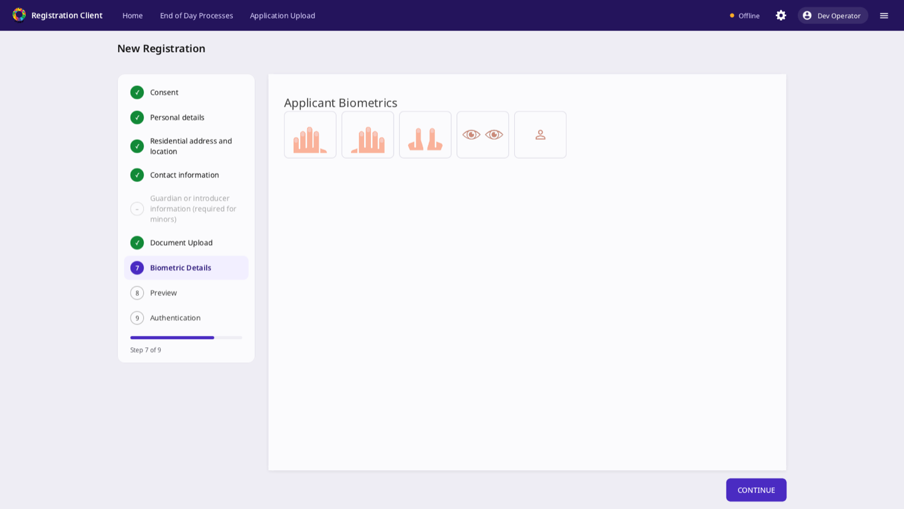 Compact biometrics; step skipped by a rule |
| 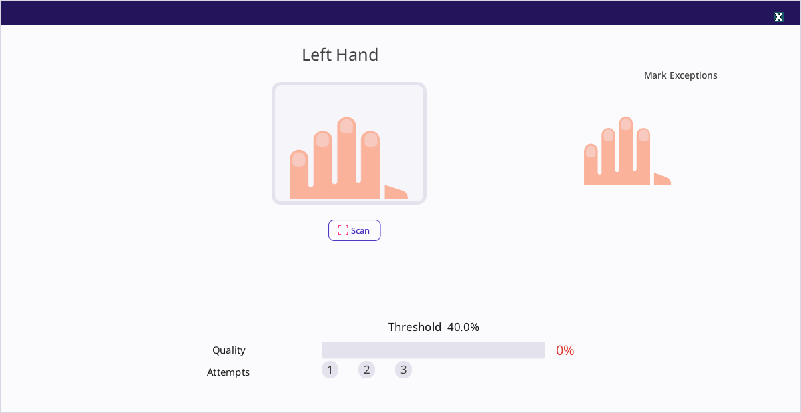 Compact biometrics: capture popup | 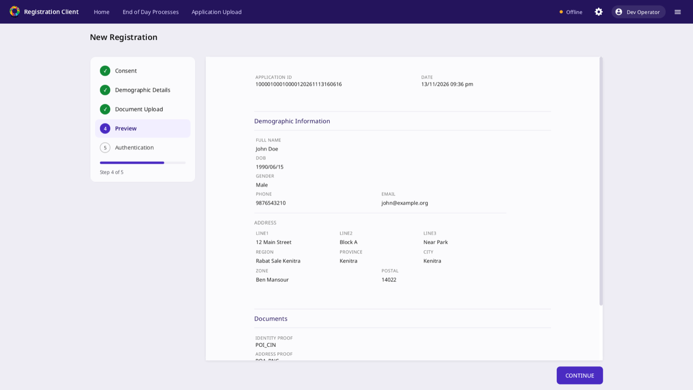 Spec without biometrics |
| 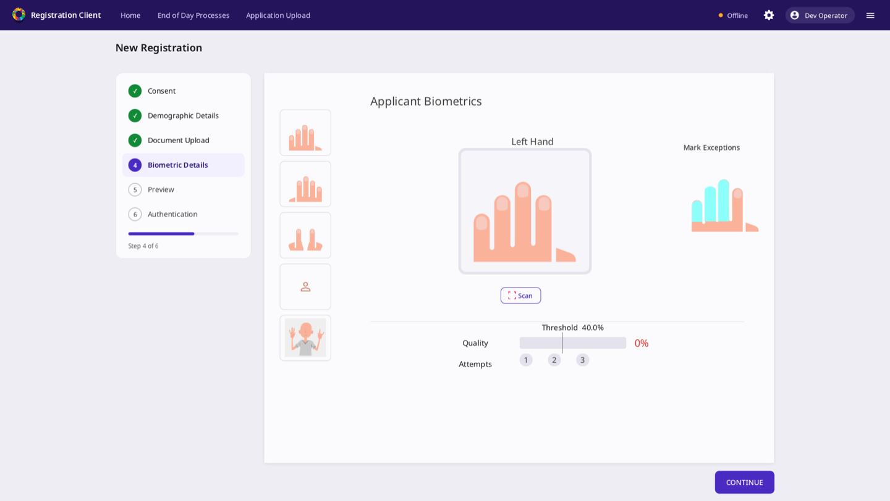 Partial biometrics (4 fingers + face) | 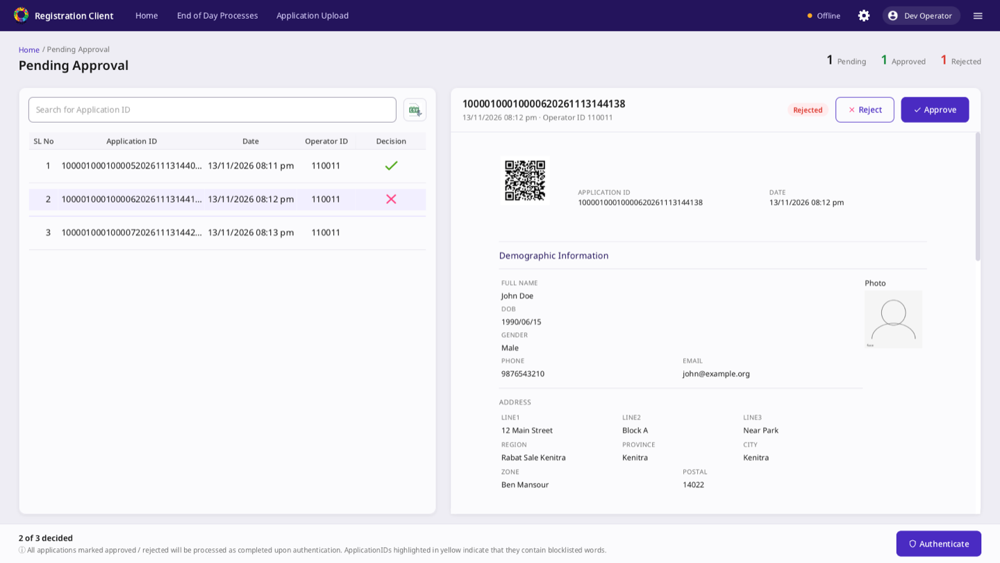 Pending approval: decisions |
| 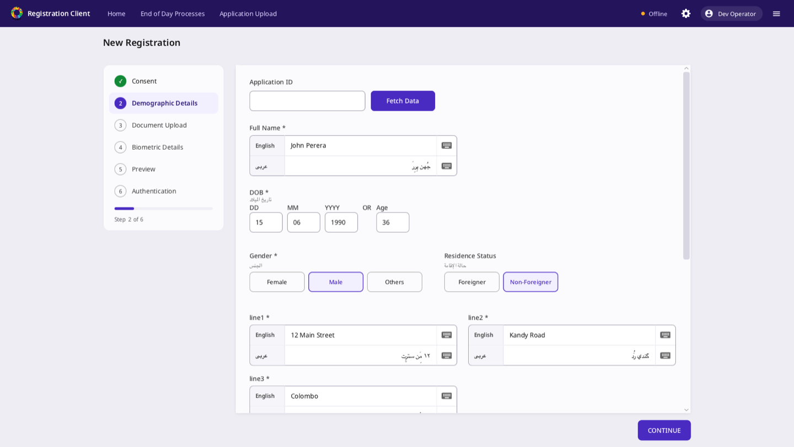 English + Arabic | 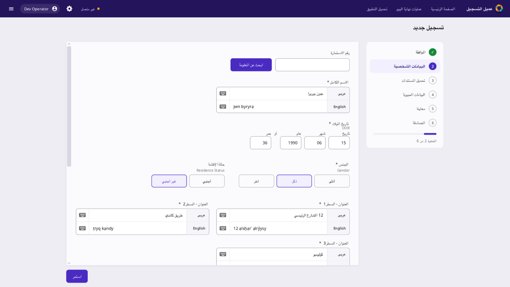 Arabic main: whole screen RTL |
| 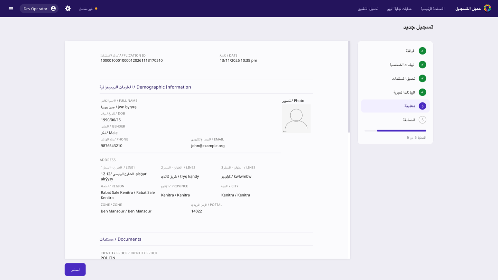 Arabic main: preview | 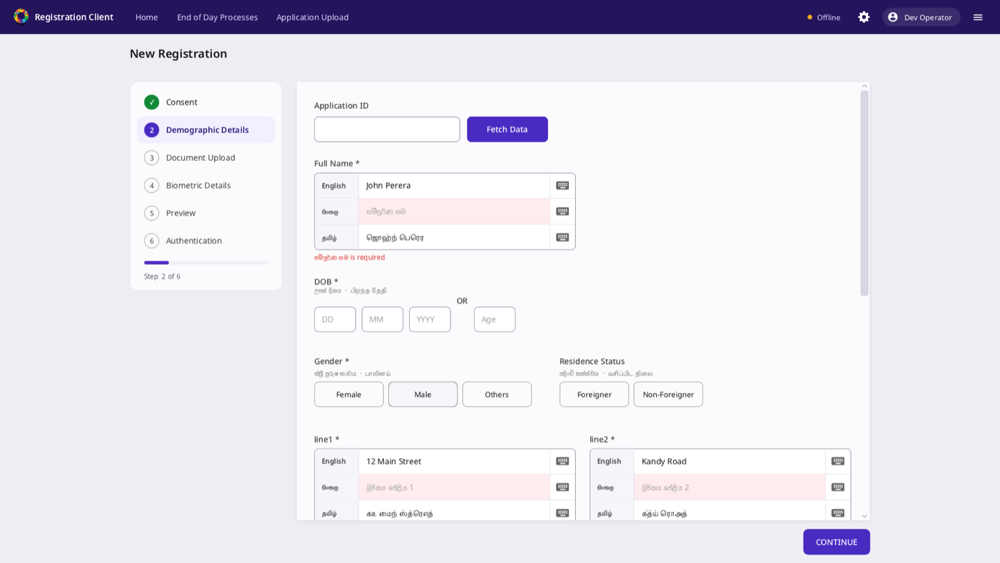 English + Sinhala + Tamil |
| 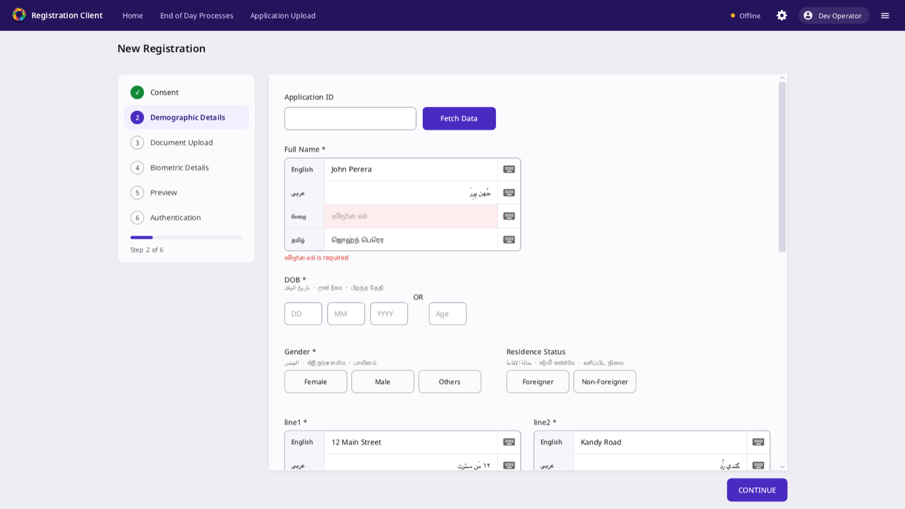 Four languages | 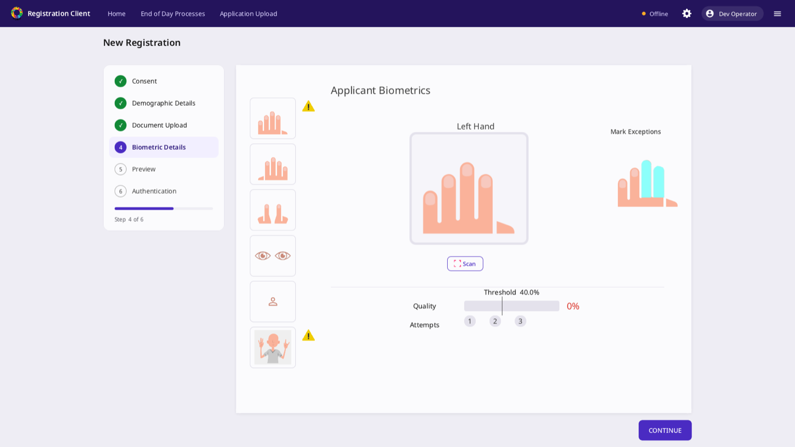 Exceptions: two fingers marked |
| 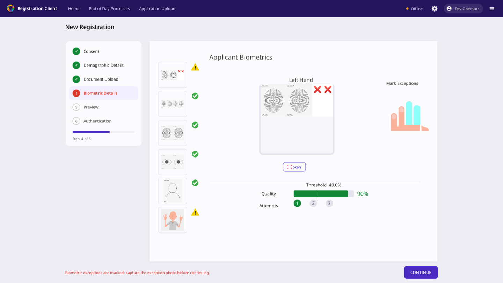 Exceptions: photo required | 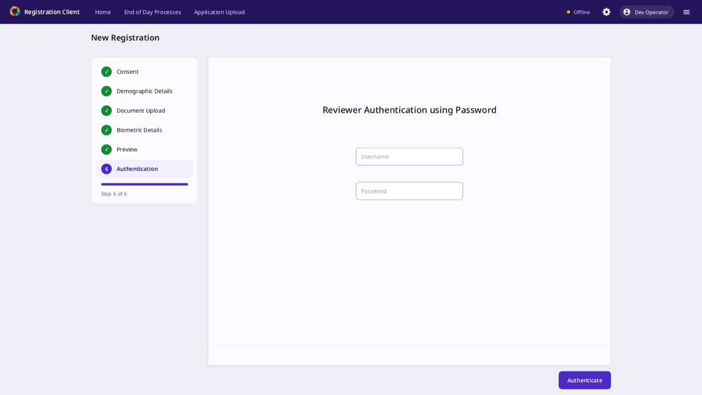 Exceptions: reviewer authentication |
| 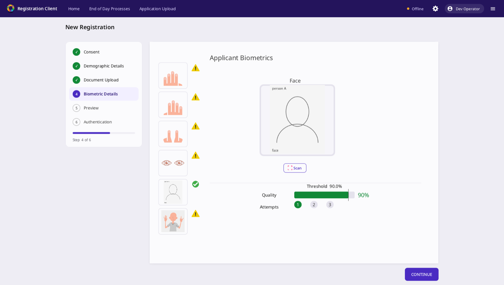 Exceptions: all but face | 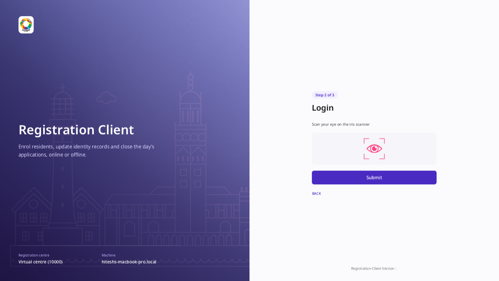 Multi-factor login, step 2 |
|  Biometric login: no device | 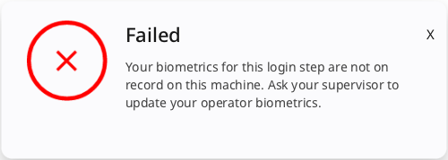 Biometric login: modality not enrolled |

### Before (original `develop`, for reference)

| | |
| --- | --- |
|  Startup |  Login |
